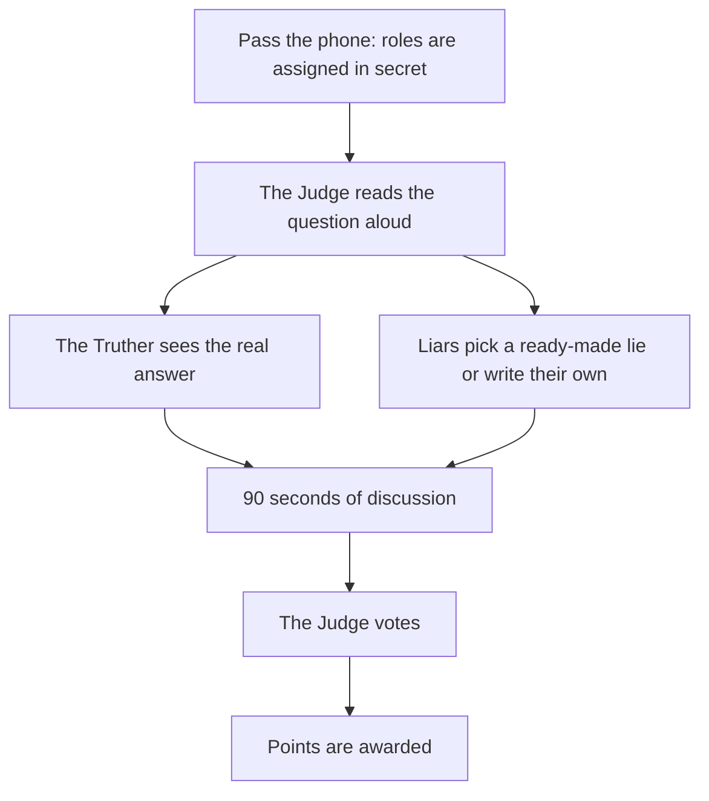

<h1>FACTAKE</h1>

<b>Bluff, persuade, manage the chaos.</b> 
A local party game about persuasion, not knowledge. One phone, passed around the table.

---

## The idea

Most trivia games reward whoever knows the answer. In FACTAKE, knowing the answer is not enough: you have to **convince** someone. One player judges, one player knows the truth, and everyone else lies. There are no teams; everyone plays for themselves.

This project was my first experience in mobile game development.

## How a round works

| Role | What you see | Your goal |
|---|---|---|
| ⚖️ **Judge** | The question | Find the player telling the truth |
| ✅ **Truther** | The real answer | Convince the Judge |
| 🎭 **Liar** | Nothing | Make the Judge believe your lie |

## Scoring

| Outcome | Points |
|---|---|
| The Judge picks the Truther | Judge **+2**, Truther **+2** |
| The Judge picks a Liar who used a ready-made lie | Liar **+3** |
| The Judge picks a Liar who made up their own lie | Liar **+4** |

Writing your own lie is riskier, so it pays more.

## Chaos rounds

Four optional rounds, toggled in the settings, keep the game from getting predictable:

| Round | Rule |
|---|---|
| 🚫 **Forbidden Letter** | A letter is banned (e.g. "A"). Nobody may use a word that contains it. |
| 🔤 **Mandatory Word** | The game gives an unrelated word, and every player has to work it into their argument. |
| 🔄 **Answer Swap** | At 45 seconds the screen goes black and everyone takes the answer of the player on their right. Now defend that one. |
| ⏱️ **Rapid Fire** | No discussion. Each player gets one minute to argue without interruption. |

## Development and AI usage

| Area | How it was made |
|---|---|
| Game design and rules | 100% my own: the concept, the chaos rounds and the scoring |
| UI and UX | 100% my own: all screens and user flows |
| Code | About 50% AI-assisted: the architecture and game logic are mine; I used LLMs for debugging, optimisation and boilerplate |

## Roadmap

- [x] Core gameplay
- [x] Chaos rounds
- [ ] UI polish
- [ ] Final question database
